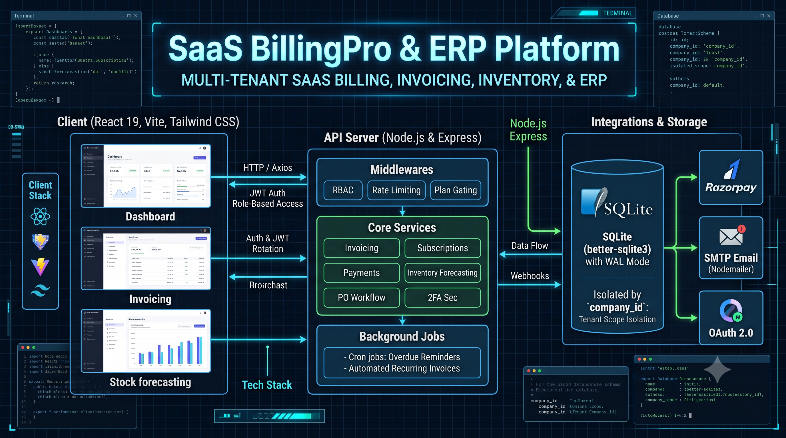
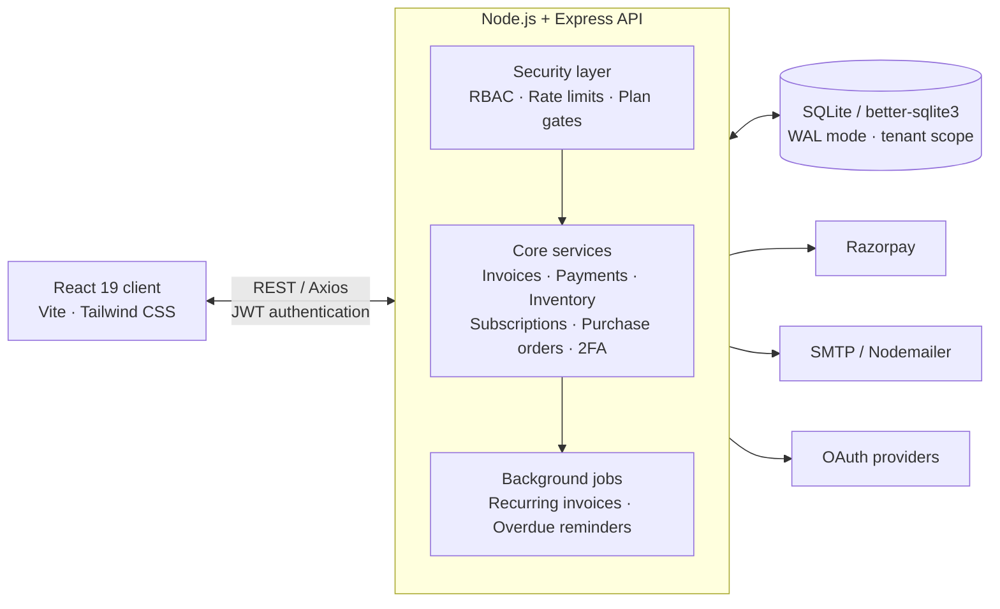

<div align="center">

  

  # BillingPro — SaaS Billing & ERP

  **A multi-tenant command center for invoicing, payments, inventory, purchase orders, and customer operations.**

  [](https://nodejs.org/)
  [](https://react.dev/)
  [](https://expressjs.com/)
  [](https://www.sqlite.org/)
  [](https://www.docker.com/)

  [Overview](#-at-a-glance) · [Architecture](#-architecture) · [Run locally](#-quick-start) · [Deploy](#-docker-deployment)

</div>

---

## ✦ At a glance

BillingPro brings the financial and operational workflow for a company into one tenant-isolated platform. Teams can draft an invoice, take a partial or online payment, keep inventory accurate, follow a purchase order through receipt, and automate the routine follow-up work around it.

| Workspace | What it handles |
| --- | --- |
| **Invoicing** | GST-aware invoices, line items, discounts, PDFs, email delivery, recurring schedules, and overdue reminders. |
| **Collections** | Partial payments, payment ledger, Razorpay checkout and verified webhook flow. |
| **Inventory** | Product stock, stock movements, low-stock awareness, and velocity-based stockout forecasts. |
| **Procurement** | Suppliers and purchase-order workflow from draft through receipt. |
| **Operations** | Customers, dashboard metrics, reports, notifications, users, roles, and company settings. |

## ⚡ Product capabilities

### Invoice to payment, without losing the audit trail

- Create catalog or custom invoice lines with server-calculated taxes and discounts.
- Generate invoice PDFs and send them through SMTP.
- Accept manual and Razorpay payments with duplicate-reference and overpayment protection.
- Track draft, sent, partial, paid, overdue, cancelled, and other lifecycle states.
- Produce recurring invoices and send overdue reminders through scheduled background jobs.

### Inventory that follows the financial workflow

- Maintain product quantities and an immutable movement history.
- Deduct stock when an invoice is settled and restore it when applicable lifecycle changes occur.
- Receive purchase orders into stock and forecast potential stockouts from recent sales velocity.

### Built for teams and tenants

- Scope company data with `company_id` across repositories and API operations.
- Apply role-based access control, plan limits, rate limiting, secure headers, audit events, and login lockout rules.
- Use JWT access tokens with refresh-token rotation, optional Google OAuth, and TOTP two-factor authentication.

## 🧭 Architecture



| Layer | Building blocks |
| --- | --- |
| **Client** | React 19, Vite, Tailwind CSS, React Hook Form, Axios, Recharts, Framer Motion |
| **API** | Node.js, Express, REST v1 routes, Swagger/OpenAPI, Winston logging |
| **Data** | SQLite through `better-sqlite3`, WAL mode, migrations, repositories, tenant-aware queries |
| **Integrations** | Razorpay, SMTP/Nodemailer, Google OAuth, Twilio, PDFKit, QR code generation |
| **Automation** | `node-cron` jobs for recurring invoices and overdue reminders |

## 🗂️ Repository map

```text
.
├── client/                  # React/Vite application
│   └── src/
│       ├── context/         # Auth, theme, and company state
│       ├── layouts/         # Sidebar, topbar, and app shell
│       ├── pages/           # Dashboard, invoices, inventory, reports, settings
│       └── services/        # Axios client and API integrations
├── server/                  # Express API
│   ├── controllers/         # HTTP request handlers
│   ├── cron/                # Recurring invoice and reminder jobs
│   ├── middleware/          # Auth, authorization, plans, rate limits, errors
│   ├── migrations/          # SQLite schema migrations
│   ├── repositories/        # Tenant-aware data access
│   ├── routes/v1/           # Versioned REST endpoints
│   └── services/            # Billing and operational business rules
├── docs/                    # Product and architecture visuals
├── docker-compose.yml       # Production service composition
└── DEPLOYMENT.md            # Deployment guidance
```

## 🚀 Quick start

### Prerequisites

- Node.js **20+**
- npm **10+**
- Docker Desktop (optional, for the containerized stack)

### 1. Configure and run the API

```bash
cd server
npm install

# macOS/Linux
cp .env.example .env

# Windows PowerShell
# Copy-Item .env.example .env

npm run dev
```

The API reads its development port from `server/.env` (`5000` in the example). Interactive API documentation is available at `http://localhost:<PORT>/api/docs`.

### 2. Run the web app

In a second terminal:

```bash
cd client
npm install
npm run dev
```

By default, Vite serves the client at the URL it prints in the terminal. The supplied environment template uses `http://localhost:5174` as the frontend origin; keep `FRONTEND_URL` aligned with your Vite port.

## 🔐 Configuration

Copy `server/.env.example` to `server/.env` and replace all placeholder values before running outside a local environment.

| Group | Key settings |
| --- | --- |
| **Core** | `NODE_ENV`, `PORT`, `FRONTEND_URL`, `APP_NAME` |
| **Auth** | `JWT_SECRET`, `JWT_ACCESS_EXPIRE`, `JWT_REFRESH_SECRET`, `JWT_REFRESH_EXPIRE` |
| **Email** | `SMTP_HOST`, `SMTP_PORT`, `SMTP_USER`, `SMTP_PASS`, `EMAIL_FROM` |
| **Payments** | `RAZORPAY_KEY_ID`, `RAZORPAY_KEY_SECRET`, `RAZORPAY_WEBHOOK_SECRET` |
| **OAuth** | `GOOGLE_CLIENT_ID`, `GOOGLE_CLIENT_SECRET` and optional GitHub/Microsoft credentials |
| **Messaging** | `TWILIO_ACCOUNT_SID`, `TWILIO_AUTH_TOKEN`, sender identifiers |

Never commit `server/.env`, credentials, database files, or generated uploads.

## 🐳 Docker deployment

```bash
# Create and configure server/.env first
Copy-Item server/.env.example server/.env   # PowerShell

docker compose up -d --build
```

The composition starts the API on port `5001` and the web client on port `80`, with persistent named volumes for the SQLite database and uploads. See [DEPLOYMENT.md](DEPLOYMENT.md) for production setup, reverse-proxy, backup, and operations notes.

## ✅ Verification

```bash
# Backend tests
cd server
npm test

# Frontend production bundle
cd ../client
npm run build
```

## 📚 API documentation

Start the server and open `/api/docs` for the Swagger UI, or retrieve the raw OpenAPI document at `/api/docs.json`.

## 📄 License

Released under the [MIT License](LICENSE).
